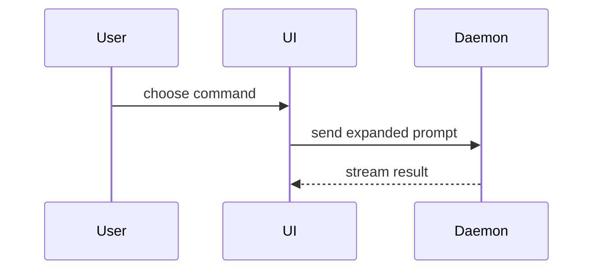

# Pull Request Body (`/pr`)

Write a PR body that lets a human reviewer grasp the shape of the change, see proof that it works, and judge merge risk in under 30 seconds.
Keep the body under about 40 lines, since it often becomes the squash commit body; move full SHAs, long logs, and file-by-file lists into a collapsed `<details>` block or a linked artifact.

## Pre-Check: Respect Repository PR Templates

1. Check the repository for a PR or merge request template in every standard location: `.github/pull_request_template.md`, `.github/PULL_REQUEST_TEMPLATE.md`, `.github/PULL_REQUEST_TEMPLATE/`, a root `PULL_REQUEST_TEMPLATE.md`, `docs/PULL_REQUEST_TEMPLATE.md`, and `.gitlab/merge_request_templates/`. Names are case-insensitive.
2. If a repo template exists, preserve its required headings/checklists and place `Summary`, `Evidence`, and `Merge Danger` cleanly inside or alongside its structure so repo automation never breaks.

## Template

Use this template for writing the PR body:

```markdown
## Summary

<diagram, diff-sketch, or tree>

## Evidence

- **Before:** <screenshot/output/failing test run>
  **After:** <screenshot/output/passing test run>

## Merge Danger

**Door:** <one-way or two-way>

<optional: description>

**Blast Radius:** <one-word description>

<optional: potential ramifications of merge>

**Safety Fact:** <the one fact it is safe because of, and its proof level>
```

## Sections

Skip all preambles and keep prose brief. Use the user's domain language from `GLOSSARY.md`. Start directly at `## Summary`.

### Summary

Pick the smallest view that makes the key point clear.

- Show logic or an algorithm as pseudocode:

```text
on(save)
  if content is unchanged
    return cached result
  write new content
  return fresh result
```

- Show runtime control flow as a call tree:

```text
submitForm
  createSession
    persistPrompt
    launchAgent
  navigateToSession
```

- Show UI structure as a component tree, including state and module boundaries that matter:

```text
<SessionPage> (apps/example/src/routes/session.tsx)
  useSessionEvents()
  <SessionToolbar>
    <RunSkillButton> (packages/ui)
```

- Show file responsibility or a broad refactor as a shallow file tree:

```text
src/
├── commands/       # parses user actions
├── sessions/       # owns session state
└── transport/      # sends API requests
```

- Show component interaction, control flow, or data flow with Mermaid:



- Use `diff` when the point is what changes and the surrounding shape already exists. Match the diff shape to the topic.

For a component change:

```diff
 <SessionPage>
   useSessionEvents()
   <SessionToolbar>
+    <RunSkillButton />
   <SessionTimeline>
+    <SkillResultCard />
```

For a file-layout change:

```diff
 src/
 ├── commands/
+│   └── show-me.ts       # expands the slash command
 ├── sessions/
-└── transport.ts
+└── transport/
+    ├── client.ts
+    └── stream.ts
```

For a call-tree or call-stack change:

```diff
 submitForm
   createSession
     persistPrompt
+    expandSkillMention
     launchAgent
-  navigateToSession
+  navigateToSession
+    subscribeToEvents
```

For a state or control-flow change:

```diff
 on(save)
-  write content
+  if content is unchanged
+    return cached result
+  write new content
+  invalidate cache
```

- Show the whole block when most of it is new, when omitted context would hide ownership or order, or when the user needs a copyable target shape:

```ts
function expandSkill(command: string): string {
  const skillName = command.slice(1);
  return `use the ${skillName} skill`;
}
```

#### Guidance

Place each visual next to the short text it supports. Keep only the calls, files, props, states, and boundaries needed to answer the user's current question or the options to resolve the current discussion point.

You may use one of these, you may use several, it is unlikely you will use all of them. Use your judgement and don't overwhelm the user.

Under the visual, add 2–3 tight bullets that name what changes for the consumer or caller, and what the next maintainer inherits. Use Mermaid only when the body renders on the GitHub or GitLab web UI. End the Summary with a one-line **Scope**: what the change covers and what it deliberately leaves out (a follow-up, a known gap).

### Evidence

Concrete evidence that the change works. Show a before and after.

Screenshots are S-tier - when the environment is set up for it and the change is visual.

Execution-based evidence is A-tier. Test results, console output. Show the exact test that now fails and passes, using pseudocode.

Never write `"All tests pass"` as a bare claim. Show the concrete observation that was false/missing before and is verified now:
* **Behavioral Seam Test**: The exact test case name(s) and assertion summary that failed on the base commit and pass now.
* **Runtime Verification (`Prove It Works`)**: The exact CLI command, API response, benchmark, or UI screenshot comparison captured before and after the change.

In `## Evidence` and `## Merge Danger`, every behavior, performance, or risk claim carries its evidence pointer or an explicit label: **Measured** (observed, with the pointer), **Inferred** (reasoned from code or docs), or **Unverified**.
For performance, lead with one primary number and its unit, `before -> after` (`p95 412ms -> 188ms`), and link the rest. An inconclusive run, or a check on a different surface than the claim (a unit test for a UI claim, staging for a production-only path), is not evidence: label the claim **Unverified**.

### Merge Danger

Describe whether it's a one-way or two-way door. You can walk back through two-way doors, but not one-way doors. A PR that is cheap to roll back is lower risk. Changes that involve destructive actions or hard-to-reverse decisions are one-way doors.

The blast radius is the potential impact or scope of the changes introduced by this PR. Consider all possibilities. Examples are layout shift, breakages for consumers, mobile responsiveness, etc.

* **Door Type**:
  * **Two-Way Door**: Reverting the commit cleanly restores previous state with no external side effects.
  * **One-Way Door**: Hard or impossible to reverse by `git revert` alone (e.g., destructive DB schema migration, persisted data format change, public contract removal, outbound external side effects). Flag one-way doors prominently so reviewers slow down.
* **Blast Radius**: Name the exact callers, endpoints, jobs, or user flows that could break if this change has a defect, and note any rollout guards (feature flags, expand-contract stage). Include the cross-boundary consumers the `blast-radius` skill finds beyond a symbol search.
* **Safety Fact**: Name the one fact the change is safe because of. Before writing this section, use the `blast-radius` skill to grade that fact on its `## Proof Ladder`. Levels 4–5 are **Measured**, 2–3 **Inferred**, 1 **Unverified**. Below level 4, report the fact as unproven the way the `blast-radius` skill's report does. If the change is a One-Way Door or touches a cross-boundary contract (serialized or wire formats, DB columns, FFI, feature flags) and the highest Safety Fact is below level 4, use the `blast-radius` skill for its full audit before the PR is opened.

The Summary's menu of visuals and its placement guidance come from `show-me`; see [CREDITS.md](CREDITS.md).

## Plain Speech

Write every sentence with a concrete actor and verb ("the migration drops column `x`", "`retry()` now returns the last error") and attach evidence to every claim. Before finalizing the body, use the `unslop` skill on it, keeping identifiers, numbers, and evidence pointers unchanged. If the branch touches 3 or more files or has more than one commit, also use the `unslop` skill to audit the prose the branch adds relative to its base branch (docs and code comments), and report proposed rewrites instead of editing files the request did not name.
